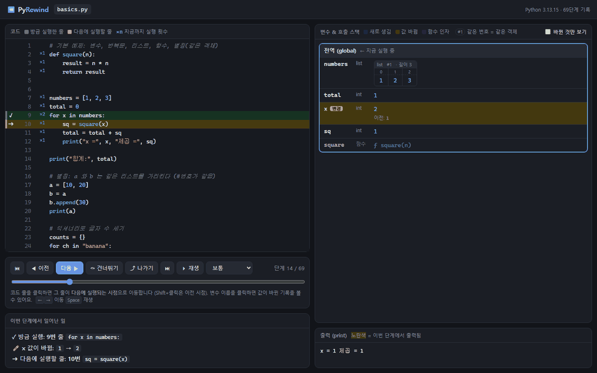
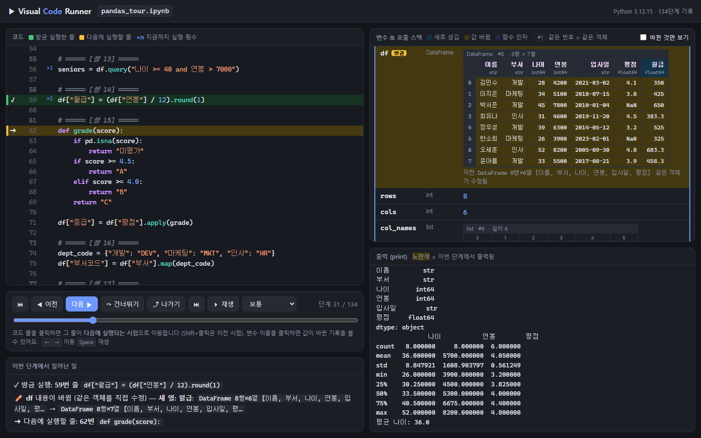
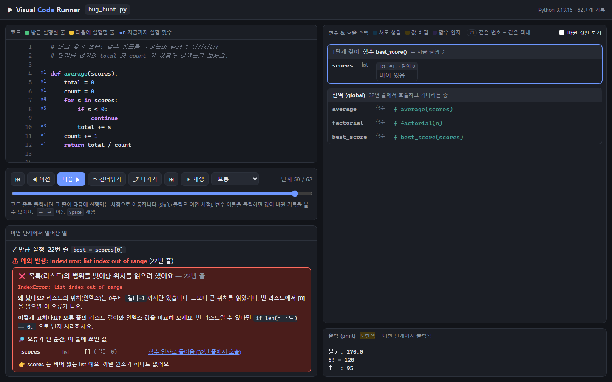
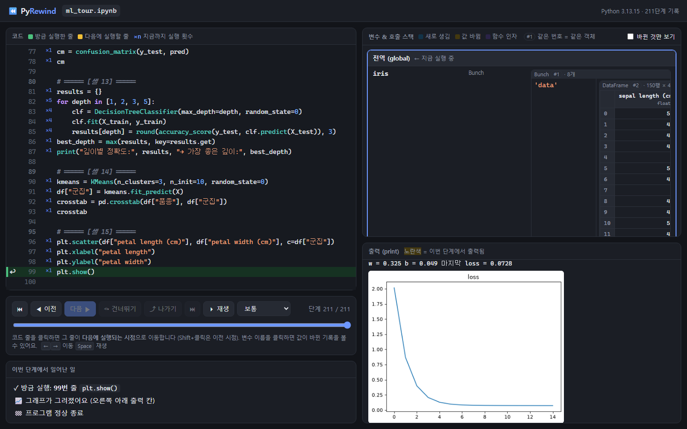

# ▶ Visual Code Runner

[English](README.md) | **한국어**

`print`로 찍힌 **결과만** 보고 디버깅하기 어려울 때 쓰는 도구입니다.
파이썬 코드를 **한 줄씩** 실행하면서, 변수가 만들어지고 바뀌는 과정을 앞뒤로 넘겨 볼 수 있어요.
`.py`와 `.ipynb`(주피터 노트북)를 지원하며 VS Code 안에서 쓰거나 브라우저로 볼 수 있습니다.



## 이런 걸 볼 수 있어요

- 변수가 **언제 만들어지고 언제 바뀌는지** (이전 값 → 새 값)
- 함수가 **호출될 때 인자로 무엇이 들어오고**, 무엇을 **반환**하는지 (호출 스택)
- 리스트·딕셔너리·객체·DataFrame의 **어느 칸이 바뀌었는지**
- 두 변수가 **같은 객체**를 가리키는지 (`#1` 같은 번호)
- 각 줄이 **몇 번 실행됐는지** (반복문 이해에 좋아요)
- 오류가 나면 **한국어로 원인과 해결 방법**, 문제의 값이 **어디서 왔는지**, 이름 오타 추천까지

| pandas: 새 열이 생기는 순간 | 오류 도우미 | 머신러닝: 학습과 그래프 |
|---|---|---|
|  |  |  |

## 설치 (가상환경 권장)

```bash
git clone <이 저장소 주소>
cd visual-code-learner
python -m venv .venv
.venv\Scripts\activate            # macOS/Linux: source .venv/bin/activate
pip install -e .                  # 도구 자체는 표준 라이브러리만 사용
pip install -e ".[examples]"      # 예제 노트북용 (pandas, numpy, matplotlib, scikit-learn)
```

## 사용법

### VS Code 확장 (추천)

```bash
python build_vsix.py --install     # dist/*.vsix 를 만들고 VS Code 에 설치
```

설치한 뒤 VS Code에서 `Developer: Reload Window`를 실행하세요. 친구에게는 `dist/*.vsix` 파일을 보내면 됩니다(확장 → `…` → **VSIX에서 설치**).

| 동작 | 방법 |
|---|---|
| 현재 파일(.py / .ipynb) 시각화 | `Ctrl+Alt+V`, 왼쪽 아래 **▶ 코드 시각화** 버튼, 에디터 오른쪽 위 ▶ 버튼 |
| 다음 / 이전 단계 | 패널 안에서 `→` `←` (에디터에서는 `Ctrl+Alt+]` / `Ctrl+Alt+[`) |
| 커서가 있는 줄이 실행되는 시점으로 이동 | `Ctrl+Alt+J` |
| **선택한 부분만** 시각화 (R / Spyder 처럼) | 줄을 드래그하고 `Ctrl+Alt+Shift+V` 또는 우클릭 → "선택한 부분만 시각화" |
| `# %%` 블록 / 노트북 셀 하나만 | 선택 없이 `Ctrl+Alt+Shift+V` (커서가 있는 블록), 노트북은 셀 위 툴바 버튼 |

- **선택 실행 동작:** 선택 영역 앞의 코드(이전 셀)는 기록 없이 먼저 실행해서 변수를 준비합니다. 그다음 선택한 줄만 한 줄씩 기록하고, 선택 영역이 끝나면 멈춰요. 선택한 줄에서 부른 함수 안쪽도 같이 기록합니다. 함수 안쪽 줄을 선택하면 그 함수가 호출될 때마다 기록됩니다.
- 단계를 넘기면 **에디터의 줄도 함께 강조**되고, 줄 끝에 변화(`◀ total: 5 → 14`)가 표시됩니다.
- 오류 줄에는 빨간 밑줄이 생기고, 오타는 **전구(💡) 빠른 수정**으로 클릭 한 번에 고칠 수 있어요.
- Python 확장에서 선택한 인터프리터를 쓰고, 없으면 작업 폴더의 `.venv`를 자동으로 찾습니다.

### 명령어 (브라우저로 보기)

```bash
vcr 내코드.py                    # 실행 후 브라우저에서 시각화 화면이 열림
vcr 노트북.ipynb                 # 코드 셀을 순서대로 이어서 실행
vcr 내코드.py --stdin 입력.txt    # input() 에 넣을 값을 파일에서 한 줄씩 읽음
vcr 내코드.py --max-steps 10000  # 기록할 단계 수 늘리기 (기본 3000)
vcr 내코드.py -o 결과.html        # 결과 HTML 저장 (파일 하나라 친구에게 보내기 쉬움)
vcr 내코드.py --lines 12-15      # 12~15번 줄만 기록 (앞부분은 미리 실행)
vcr 노트북.ipynb --cell 3         # 3번째 코드 셀만 기록 (--lines 와 함께 쓰면 셀 안 줄 번호)
```

### PyCharm

**Settings → Tools → External Tools → `+`** 에서 Program `vcr`, Arguments `"$FilePath$"`, Working directory `$FileDir$`로 등록하고, **Keymap**에서 단축키를 지정하면 됩니다.

## 화면 보는 법

| 표시 | 의미 |
|---|---|
| 🟩 초록 줄 | 방금 실행한 줄 (변수 패널의 변화는 이 줄이 만든 것) |
| 🟨 노란 줄 | 다음에 실행할 줄 |
| 🟥 빨간 줄 | 오류가 난 줄 |
| `×3` | 지금까지 그 줄이 실행된 횟수 |
| `NEW` / `변경` / `인자` | 새로 생긴 변수 / 값이 바뀐 변수 / 함수에 들어온 인자 |
| `#1`, `#2` | 객체 번호. 번호가 같으면 **같은 객체**라서 한쪽을 바꾸면 다른 쪽도 바뀜 |

**조작:** `←` `→` 한 단계씩 · `↓` 함수 건너뛰기 · `↑` 함수 나가기 · `Space` 자동 재생
· **코드 줄 클릭** = 그 줄이 실행되는 시점으로 이동 · **변수 이름 클릭** = 값이 바뀐 기록

## 오류 도우미

- **왜 났나요? / 어떻게 고치나요?**: 자주 나는 오류 약 20가지를 초보자 눈높이로 설명합니다 ([errors.py](visual_code_runner/errors.py)).
- **오류가 난 순간, 이 줄에 쓰인 값**과 그 값이 **어디서 왔는지**("함수 인자로 들어옴 (32번 줄에서 호출)") 링크
- **이름 오타 추천**: 오류가 난 순간의 실제 객체에서 쓸 수 있는 이름(`dir()`, 함수 인자 목록)을 꺼내 가장 비슷한 이름을 추천

  | 잘못 쓴 코드 | 추천 |
  |---|---|
  | `df.groupbyy()`, `np.arrange()`, `nums.apend()` | `groupby`, `arange`, `append` |
  | `prnt()`, `total_scor`, `df["연봉2"]` | `print`, `total_score`, `연봉` |
  | `import pandsa`, `from sklearn.metrics import accuracy_scor` | `pandas`, `accuracy_score` |
  | `train_test_split(..., test_sise=0.3)` | `test_size` (받을 수 있는 인자 목록도 표시) |
  | `import notarealpackage` | `pip install notarealpackage` 안내 |

결과는 틀렸지만 오류는 나지 않는 버그는 자동으로 찾지 못합니다. 변수 이름을 클릭해 값이 바뀐 기록을 따라가 보세요.

## 노트북 · pandas · 머신러닝

- 셀의 마지막 줄이 식이면 주피터처럼 값을 출력하고, `display()`도 쓸 수 있어요. `%matplotlib`, `!pip` 같은 노트북 전용 명령은 건너뜁니다.
- DataFrame / Series / numpy 배열은 **표나 칸**으로 보여주고, 바뀐 칸과 새 열을 강조합니다.
- `plt.show()`로 그린 그래프는 **출력 칸에 이미지로** 나옵니다.
- `apply(내함수)`처럼 라이브러리가 내 함수를 호출하면 그 함수 안도 한 줄씩 보입니다. 반대로 `model.fit()` 같은 라이브러리 내부 계산은 한 단계로 지나갑니다.
- 예제: [pandas_tour.ipynb](examples/pandas_tour.ipynb) (32셀), [ml_tour.ipynb](examples/ml_tour.ipynb) (15셀)

## 동작 원리

```
 내 코드 (.py / .ipynb)
      │  notebook.py: 코드 셀을 하나의 소스로 합침 (셀 ↔ 줄 번호 표 유지)
      ▼
 tracer.py ── sys.settrace 로 call / line / return / exception 이벤트를 받음
      │       이벤트마다 호출 스택의 변수를 JSON 으로 저장 (같은 값은 한 번만)
      │       errors.py: 오류를 한국어로 설명하고 이름 오타 추천
      │       mpl_backend.py: plt.show() 그래프를 PNG 로 받아 둠
      ▼
 trace (JSON) ──▶ viewer.html: 단계별 화면 (HTML 파일 하나, 인터넷 불필요)
      │
      └──▶ VS Code 확장 (extension.js): 웹뷰 패널 + 에디터 줄 강조 + 진단 + 빠른 수정
```

## 제한 사항

- 기본 3000단계까지만 기록합니다 (무한 루프 방지, `--max-steps`로 변경).
- 지금 연 파일 하나만 한 줄씩 추적합니다. import 한 내 다른 파일의 안쪽은 보이지 않아요.
- 스레드, `asyncio`, GUI 프로그램은 제대로 보기 어렵습니다.
- 큰 컬렉션은 일부(리스트 40개, 표 12×12)만 보여주고, 큰 데이터를 많이 다루면 느려질 수 있습니다.

## 개발

```bash
pip install -e ".[dev,examples]"
python -m pytest                                  # 파이썬 테스트
node vscode-extension/test/extension.test.js      # 확장 테스트 (가짜 vscode API + 실제 트레이서)
python build_vsix.py                              # dist/*.vsix 만들기
```

- VS Code에서 이 폴더를 열고 `F5`를 누르면 확장을 개발 모드로 실행합니다.
- GitHub Actions가 Windows / macOS / Linux, Python 3.10 ~ 3.15에서 테스트를 실행합니다 ([ci.yml](.github/workflows/ci.yml)).
- README 이미지는 `python scripts/make_screenshots.py`로 다시 만들 수 있습니다 (Windows + Edge).

## 라이선스

[MIT](LICENSE)
