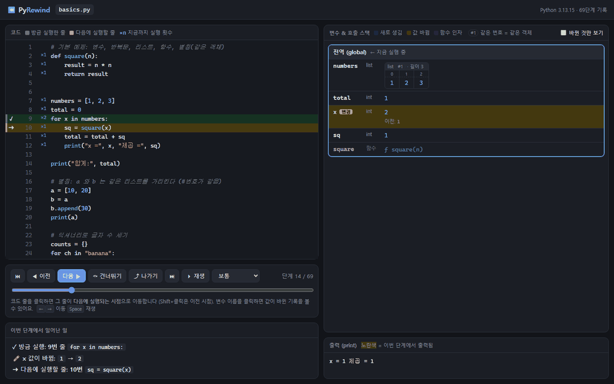
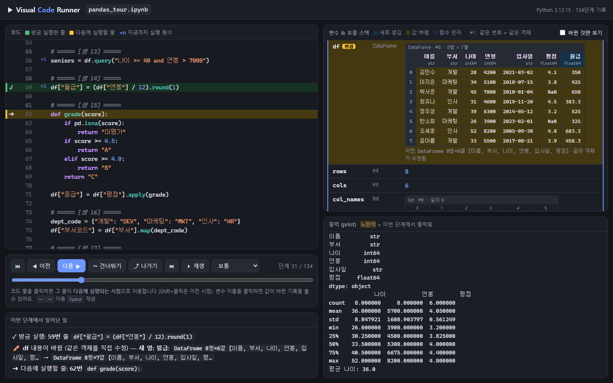
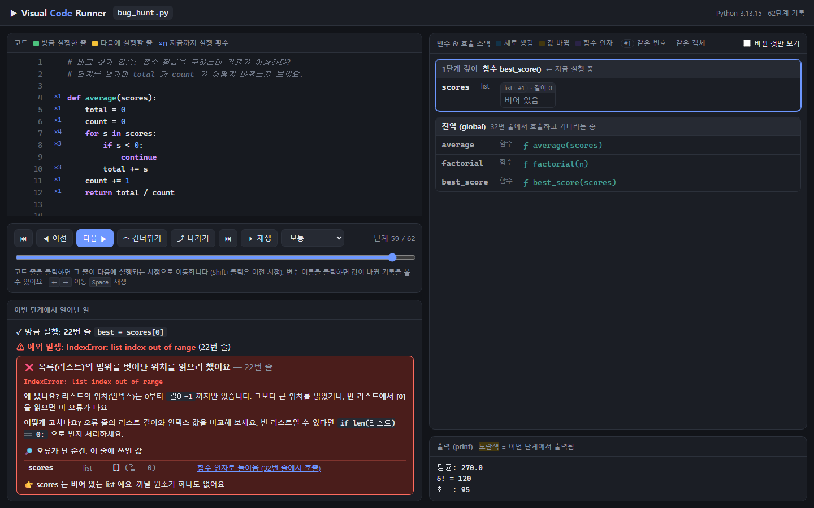
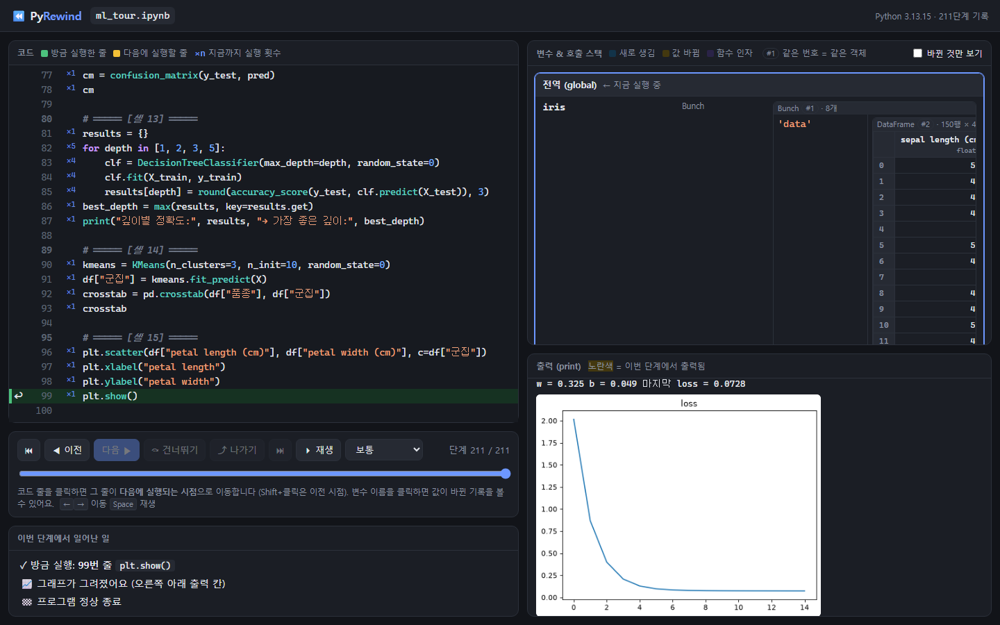

# ⏪ PyRewind

[](https://github.com/etnflash/pyrewind/actions/workflows/ci.yml) [](LICENSE) 

**English** | [한국어](README.ko.md)

*Rewind your Python, one line at a time.* (한줄씩 되감는 파이썬)

**▶ [Try it in your browser — no install](https://etnflash.github.io/pyrewind/)**

See how your Python code actually runs — line by line, **forwards and backwards**.
PyRewind records every step of a `.py` script or a whole Jupyter notebook and lets you replay it,
showing variables being created and changed, function calls, pandas DataFrames, plots, and — when
something breaks — *why* it broke and *where the bad value came from*.

Built for beginners who debug by staring at `print` output. The UI and error explanations are in Korean.



## Features

- **Step forward / backward** through every executed line; click any line to jump to when it runs next.
- **Run just a selection, a `# %%` block, or one notebook cell** (like R / Spyder): earlier code runs untraced to set up state, then only the selected lines (and functions they call) are recorded, and execution stops after the selection.
- **Variables and call stack** for each step, with *new* / *changed* / *argument* highlights and `before → after` values.
- **Structure-aware rendering**: lists as cells, dicts and objects as tables, pandas **DataFrame / Series** and numpy arrays as tables with changed cells highlighted. Aliases share an object number (`#1`), so `b = a; b.append(…)` is visible.
- **Jupyter notebooks**: all code cells run as one program; last-expression output, `display()`, and matplotlib / seaborn figures (rendered as images in the output pane) work like in Jupyter. plotly `fig.show()` becomes an interactive (rotatable 3D) chart.
- **Images, tensors, deep learning**: color arrays `(H, W, 3)`, PIL images and large 2-D arrays are drawn as pictures; 3-D+ arrays such as `(N, C, H, W)` batches or CNN feature maps are shown slice by slice with a slider. PyTorch / TensorFlow tensors show shape, dtype, device and grad; models show their layer structure and parameter count. Float feature maps / Grad-CAM maps are drawn as colour heatmaps and overlaid on a same-shaped photo variable. While running, `PYREWIND=1` is set so code can shrink its dataset for visualisation.
- **Error helper**: plain-language explanation and fix for ~20 common errors, the values used on the failing line, a link to *the step where that value was set*, and **typo suggestions** pulled from the real object at the moment of failure (`df.groupbyy` → `groupby`, `test_sise=` → `test_size`, `import pandsa` → `pandas`).
- **VS Code extension**: the viewer opens beside your editor; the current step is highlighted *in your source* (including notebook cells) with inline `◀ total: 5 → 14` hints; errors become diagnostics with **one-click quick fixes** and a `pip install` action for missing packages.
- **Zero dependencies**: the tracer uses only the Python standard library; the viewer is a single offline HTML file you can share.

| pandas: a new column appears | Error helper | ML notebook with plots |
|---|---|---|
|  |  |  |

## Quick start

```bash
git clone <this repo>
cd visual-code-learner
python -m venv .venv && . .venv/bin/activate     # Windows: .venv\Scripts\activate
pip install -e .                                 # the tool itself (stdlib only)
pip install -e ".[examples]"                     # pandas, numpy, matplotlib, scikit-learn, scipy, seaborn, pillow, plotly

pyrewind examples/basics.py                           # opens the viewer in your browser
pyrewind examples/pandas_tour.ipynb
```

`python -m pyrewind <file>` works the same if the `pyrewind` launcher is blocked (e.g. by Windows Smart App Control).

### VS Code extension

```bash
python build_vsix.py --install                   # builds dist/*.vsix and installs it (no Node.js needed)
```

Reload the window, open a `.py` / `.ipynb`, and press **`Ctrl+Alt+V`** (or click **▶ 코드 시각화** in the status bar).
The extension uses the interpreter selected in the Python extension, falling back to the workspace `.venv`.

### CLI options

| Option | Meaning |
|---|---|
| `-o out.html` | where to write the viewer (default: temp dir) |
| `--stdin inputs.txt` | values fed to `input()`, one per line |
| `--max-steps N` | recording limit (default 3000, protects against infinite loops) |
| `--loop-limit N` | record each line only its first N times; later loop iterations run unrecorded (for training loops) |
| `--json` | write the raw trace instead of HTML |
| `--lines 12-15` | record only these lines (code before them runs untraced) |
| `--cell 3` | notebooks: record only the 3rd code cell (`--lines` then counts within the cell) |

In VS Code: select lines and press **`Ctrl+Alt+Shift+V`** (or right-click → 선택한 부분만 시각화); with no selection it uses the `# %%` block under the cursor. Notebook cells have a toolbar button.

## How it works

```
 your code (.py / .ipynb)
      │  notebook.py   joins code cells into one source, keeping a cell ↔ line map
      ▼
 tracer.py      sys.settrace → call / line / return / exception events
      │         snapshots every frame's locals as JSON (identical values stored once)
      │         errors.py      Korean explanations + typo suggestions via dir()/inspect.signature
      │         mpl_backend.py captures plt.show() figures as PNG
      ▼
 trace (JSON) ──▶ viewer.html   self-contained step-through UI
      └────────▶ extension.js   webview panel, editor decorations, diagnostics, quick fixes
```

A few details that took some care:

- **Notebook line mapping** — cells are concatenated, but the extension maps every trace line back to the right cell editor (and back again for "jump to this line").
- **Last-expression display** — the AST of each cell is used to wrap only the final expression (`__pyrewind_display__((…))`) in an *execution* copy of the source, while the *display* copy stays untouched so line numbers match.
- **Where did this value come from?** — the viewer walks the recorded steps backwards to find when a variable last changed in the same frame, or which call site passed it in as an argument.
- **Size** — values are interned across steps, which cut an ML notebook trace from ~2 MB to ~260 KB.

## Limitations

- Only the file you run is traced line by line (not other modules you import); library internals such as `model.fit()` are a single step.
- Recording stops at `--max-steps` (default 3000). Threads, `asyncio` and GUI apps are not a good fit.
- Large collections are truncated in the view (40 items, 12×12 tables).

## Development

```bash
pip install -e ".[dev,examples]"
python -m pytest                                   # Python tests
node vscode-extension/test/extension.test.js       # extension tests (mock vscode API + real tracer)
python build_vsix.py                               # build dist/*.vsix
```

CI runs the Python tests on Windows / macOS / Linux with Python 3.10–3.15, plus the extension tests and a `.vsix` build ([ci.yml](.github/workflows/ci.yml)).
Press `F5` in VS Code to launch the extension in development mode. Screenshots are regenerated with `python scripts/make_screenshots.py`.

## Credits

Built with the help of [Claude Code](https://claude.com/claude-code), an AI coding assistant.

## License

[MIT](LICENSE)
