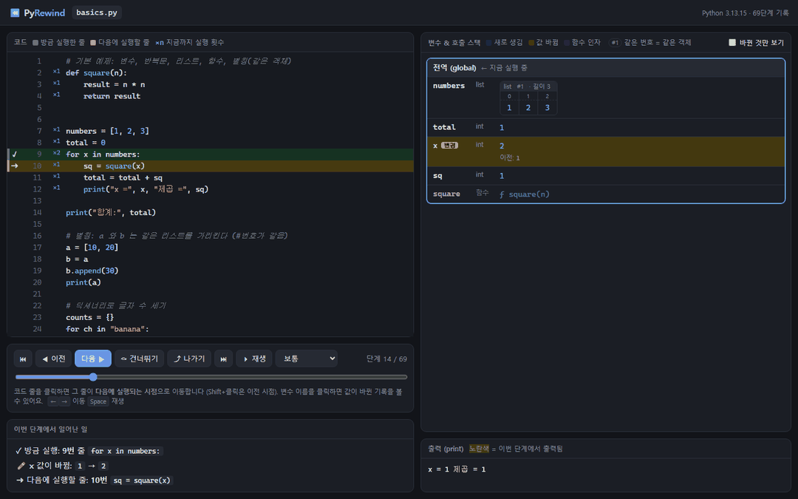
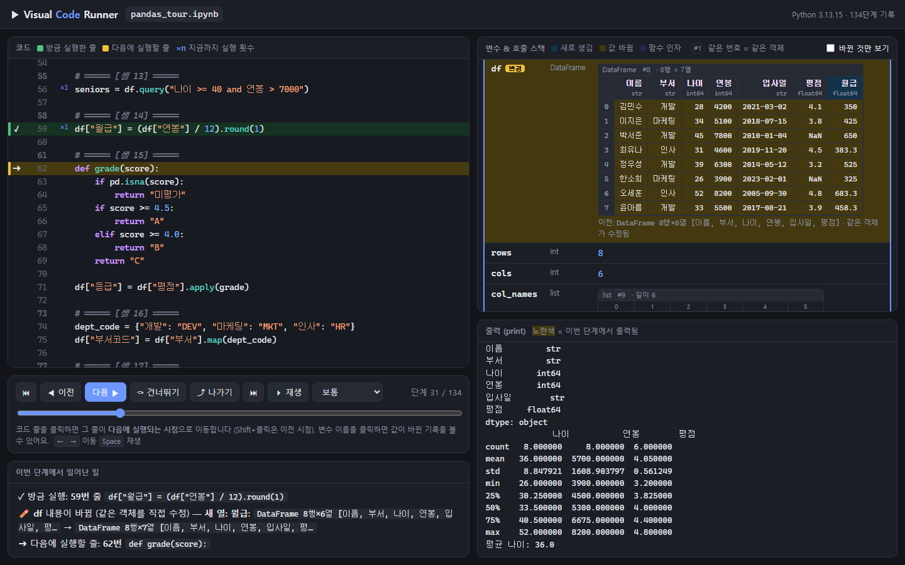
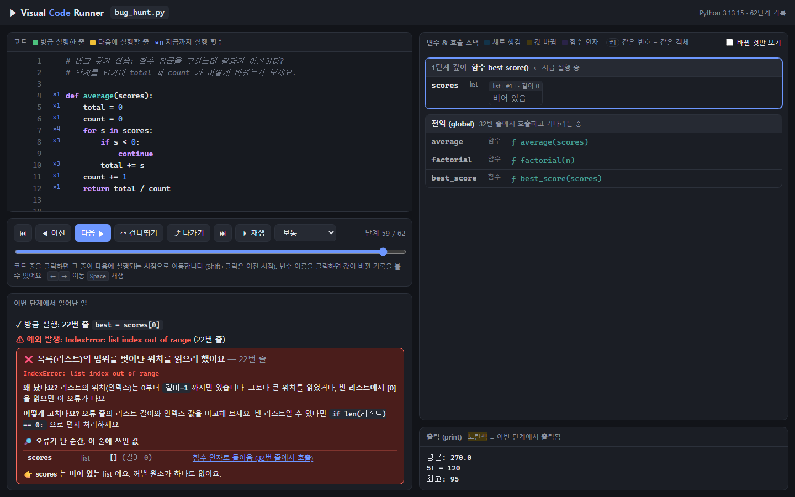

# PyRewind — 한 줄씩 되감는 파이썬

`print()`만으로 디버깅하기 어려운 분들을 위한 확장입니다.
파이썬 코드가 **한 줄씩 실행되면서 변수가 만들어지고 바뀌는 과정**을 에디터 옆 패널에서 앞뒤로 넘겨 볼 수 있어요.

👉 설치 전에 **브라우저에서 먼저 체험**해 보세요: https://etnflash.github.io/pyrewind/

## 준비물

- **Python 3.10 이상**이 설치되어 있어야 합니다. ([python.org](https://www.python.org/downloads/))
- 추가로 설치할 패키지는 없습니다. 확장 안에 실행 도구가 들어 있어요.
- [Python 확장](https://marketplace.visualstudio.com/items?itemName=ms-python.python)에서 인터프리터(가상환경 포함)를 골라 두면 그 Python을 그대로 씁니다.

## 할 수 있는 것

- **한 단계씩 앞뒤로 이동:** 실행한 줄, 함수 호출과 반환, 변수 값의 변화를 단계별로 보여줍니다.
- **바뀐 값 강조:** 리스트, 딕셔너리, 객체 안에서 바뀐 칸만 색으로 표시합니다.
- **`.py`와 `.ipynb` 모두 지원:** 노트북은 셀 단위로 표시되고, 에디터에서도 해당 셀의 줄에 강조가 붙어요.
- **pandas / numpy / matplotlib:** DataFrame은 표로, 그래프는 그림으로 보여줍니다.
- **선택한 부분만 실행:** R이나 Spyder처럼 드래그한 부분, `# %%` 블록, 노트북 셀 하나만 골라서 볼 수 있어요.
- **한국어 오류 도우미:** 오류 이유를 쉽게 설명하고, 오타가 있으면 바로 고치는 버튼을 띄웁니다. 예: `df.groupyb` → `groupby`

## 사용법

| 동작 | 방법 |
|---|---|
| 현재 파일 시각화 | `Ctrl+Alt+V`, 에디터 오른쪽 위 ▶ 버튼, 상태 표시줄의 "코드 시각화", 노트북 툴바 버튼, 탐색기 우클릭 |
| 선택한 부분만 시각화 | 코드를 드래그한 뒤 `Ctrl+Alt+Shift+V` 또는 우클릭 메뉴. 아무것도 선택하지 않으면 커서가 있는 `# %%` 블록을 실행. 노트북은 셀 위의 버튼 |
| 다음 / 이전 단계 | 패널에서 `→` `←` (에디터에서는 `Ctrl+Alt+]` / `Ctrl+Alt+[`) |
| 커서가 있는 줄이 실행되는 시점으로 이동 | `Ctrl+Alt+J` 또는 우클릭 → "이 줄이 실행되는 시점으로 이동" |

단계를 넘기면 에디터에도 같이 표시됩니다.
- 🟩 방금 실행한 줄
- 🟨 다음에 실행할 줄
- 🟥 오류가 난 줄
- 줄 끝에는 그 줄이 만든 변화가 흐리게 붙어요 (예: `◀ total: 5 → 14`).

코드에 `input()`이 있으면 실행 전에 넣을 값을 물어봅니다.

## 설정

| 설정 | 설명 |
|---|---|
| `pyrewind.pythonPath` | 비워 두면 Python 확장에서 선택한 인터프리터를 사용 |
| `pyrewind.maxSteps` | 기록할 최대 단계 수 (기본 3000, 무한 루프 방지) |
| `pyrewind.runOnSave` | 저장할 때마다 자동으로 다시 실행 |
| `pyrewind.inlineValues` | 에디터 줄 끝에 변수 변화 표시 |
| `pyrewind.timeoutSeconds` | 실행 제한 시간 (기본 60초) |

## 알아 두면 좋은 점

- 이 도구는 코드를 **실제로 실행**합니다. 파일을 지우거나 네트워크를 쓰는 코드라면 그 동작도 그대로 일어나요.
- 단계 수가 아주 많은 코드(큰 반복문, 모델 학습 등)는 `maxSteps`에서 기록이 끊깁니다. 이때는 "선택한 부분만 시각화"로 보고 싶은 부분만 골라 보세요.

## 문제 신고 · 소스 코드

GitHub: https://github.com/etnflash/pyrewind (MIT 라이선스)
